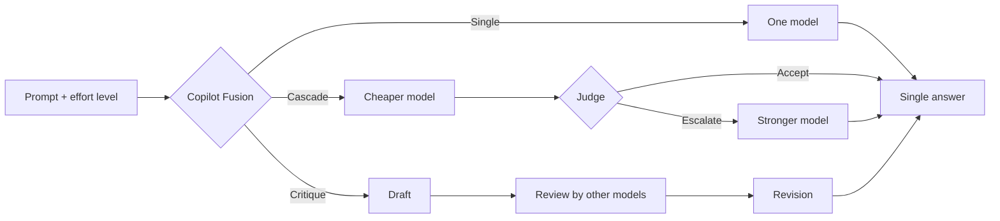

Over the past year, one of the questions I've heard most from teams is: *"Which model should I use for this?"*. Every developer ended up with their own recipe: one model for everyday work, another "for when things get hard," and a pricier one saved for emergencies. For those of us leading AI adoption in the SDLC, that meant something uncomfortable: cost and quality depended on a manual decision nobody was measuring.

At GitHub Universe (October 28, 2026), GitHub introduced **Copilot Fusion**, and what makes it interesting is that it goes straight at that problem.

## What is Copilot Fusion?

Copilot Fusion **is not a new model**. It's an orchestration engine that decides, at runtime, which model (or which combination of models) handles each task, and returns a single answer. In the words of Mario Rodriguez, GitHub's CPO: *"It's not a model. It's an orchestration engine at runtime."*

It's available on every Copilot plan, in VS Code, the GitHub Copilot app, Copilot CLI and JetBrains IDEs.

The change for developers is simple: instead of picking a model, they pick an **effort level**:

- **Standard:** versatile models for everyday work.
- **High:** more complex tasks, like hard bugs or multi-file changes.
- **Max:** favors the most capable models for the hardest problems.

## How it orchestrates models

For each prompt, Fusion picks one of three execution patterns:

- **Single:** one model answers directly.
- **Cascade:** a cheaper model drafts a solution, a "judge" evaluates it and, if it falls short, escalates to a stronger model.
- **Critique:** one model drafts, others review it, and the original model revises its draft.



The pool includes models from different providers (Artificial Analysis reported Claude Opus 5.5, Claude Sonnet 5.5 and GPT-6 models, among others), and the models used **vary by request and by the policies the organization sets**. That last part is what matters most to me as an architect, and I'll come back to it below.

## What the numbers say (and what they don't)

Artificial Analysis's independent evaluation, published the same day as the announcement, compared Fusion at Max against Claude Code with Claude Opus 5.5 at its Max setting:

| Metric | Copilot Fusion (Max) | Claude Code + Opus 5.5 (Max) |
| --- | --- | --- |
| Coding agent index score | 60 | ~62 |
| Average cost per task | USD 5.59 | USD 11.42 |

In other words: **two points behind, at roughly half the cost per task**. Fusion led on Terminal-Bench but trailed on FrontierCode (51 vs 56).

GitHub, for its part, shared bolder figures, such as cost reductions of up to 77% in its own evaluations. My advice is to keep the two apart: the independent figure is the one I'd bring to a conversation with finance; the vendor's figure is a hypothesis to validate against our own repositories.

And there's a nuance no benchmark captures: **cost per task is not the cost of shipping software**. Human review, rework and security remediation don't show up in the table.

## What changes for those leading AI in the SDLC

From where I sit, I see three concrete impacts.

### 1. Governance moves from the model to the pool

Before, approving a model was a one-off decision. With Fusion, any model in the pool may end up processing a team's code. That means data protection, residency and compliance reviews must cover **the whole pool**, not just the "favorite" model.

The good news is that Fusion respects enterprise and organization model policies: admins can see which models are eligible, disable specific models for Fusion only, and set a default effort level. In practice, this turns the allowed-model list into one more security control in the pipeline, and as such it should be versioned, reviewed and audited.

### 2. Cost metrics become engineering metrics

Fusion carries no extra charge: each model involved is billed at its standard rate. A High or Max level may call several models within a single task, so cost per task now depends on the effort level each developer chooses.

That's why, instead of measuring only "adoption" (how many people use Copilot), it's worth starting to measure:

- **Effort level distribution** by team and task type.
- **Cost per accepted PR**, not per prompt.
- **Acceptance and rework rates** for changes generated at each level.
- **Security findings** introduced or remediated in AI-assisted changes.

If Max doesn't improve the acceptance rate over Standard for a given task type, that's an immediate saving we only see if we measure it.

### 3. The developer's role keeps shifting toward evaluation

In a [previous article](/en/blog/copilot-agent-mode-dependabot/) I described how, while remediating vulnerabilities with Copilot agent mode, developers went from writing the fix to evaluating the AI's proposal. Fusion takes that shift further: now they don't even pick the tool, only how much effort to invest. One detail to keep in mind: if Fusion discards a draft, the file edits that draft already made are not rolled back. Reviewing the diff is still on us.

## How to set Fusion as the default in GitHub Copilot

The default configuration is set by enterprise admins in two steps: which models Fusion can use, and which model and effort level every new conversation starts with.

### 1. Choose the models Fusion can use

From your enterprise settings on GitHub:

1. At the top of the page, click **AI controls**.
2. In the sidebar, click **Copilot**.
3. Under **Models**, click **Configure Copilot Fusion models**.
4. Set a status for each model in the list.

This control lets you disable a model for Fusion only, without taking it away from everyone else. A model enabled here is only used if the enterprise's other model policies also allow it, so this is the place to align the pool with security and data approvals.

### 2. Set Fusion as the default model with enterprise managed settings

With *enterprise managed settings*, Fusion becomes the default model for new conversations. There are two keys:

- `model`: sets the default model for new conversations.
- `fusionTier`: sets the default effort level when the model is `fusion`. It accepts `"standard"`, `"high"`, `"max"` or `"unmanaged"`.

This is the configuration I recommend to start with: Fusion by default, at Standard, letting each person raise the level when the task needs it.

```json
{
  "model": "fusion",
  "fusionTier": { "overridable": "standard" }
}
```

If a team needs a different default (for example, a platform team working on large multi-repo changes), it can override it in its team settings file:

```json
{
  "fusionTier": "high"
}
```

If the team doesn't set `fusionTier`, the enterprise value applies. One important detail: if you set `fusionTier` to a plain value (for example `"standard"`, without `overridable`), the level is locked and neither users nor repositories can change it. Use it only if you truly need strict cost control.

### 3. Minimum client versions

These settings require recent client versions:

| Client | Minimum version |
| --- | --- |
| VS Code | 1.144.0 |
| Copilot CLI | 1.0.104-3 |
| GitHub Copilot app | 1.1.33-4 |

For developers, the change shows up in the model picker: **Copilot Fusion** appears with its levels **Fusion Standard**, **Fusion High** and **Fusion Max**. Without enterprise configuration, anyone can still pick it manually from that same picker.

> The full guide to creating the settings file is in GitHub's [enterprise managed settings](https://docs.github.com/copilot/reference/enterprise-administrators/enterprise-managed-settings) documentation.

## How I'd roll it out

If I were starting today, I'd follow these steps:

1. **Review the list of eligible models** for Fusion and align it with the organization's security and data policies.
2. **Set Fusion at Standard as the default** (as in the previous section) and keep High and Max as explicit choices.
3. **Configure budgets and alerts** before opening it to every team.
4. **Run a pilot with baseline metrics** (cost per PR, acceptance, rework) on two or three teams.
5. **Compare against current usage** before scaling. The temporary launch discount can skew the cost picture in the first weeks.

## Conclusions

Copilot Fusion changes the question from *"which model do I use?"* to *"how much effort does this task deserve?"*. For developers it's a simplification; for those of us leading AI in the SDLC it's a shift in responsibility: we stop managing individual tools and start **governing a pool of models and measuring their real impact**.

The early numbers are promising, but the decision to scale shouldn't come from a benchmark. It should come from our own engineering metrics: cost per delivered change, quality and security. AI accelerates; culture and data decide where we're headed.

Thank you for your time, and I hope this article was helpful.

**Sources:** [GitHub docs](https://docs.github.com/copilot/concepts/models/copilot-fusion), [VentureBeat](https://venturebeat.com/orchestration/github-copilot-fusion-mixes-models-to-achieve-near-opus-5-5-coding-performance-at-half-the-per-task-cost) (includes Artificial Analysis data).
