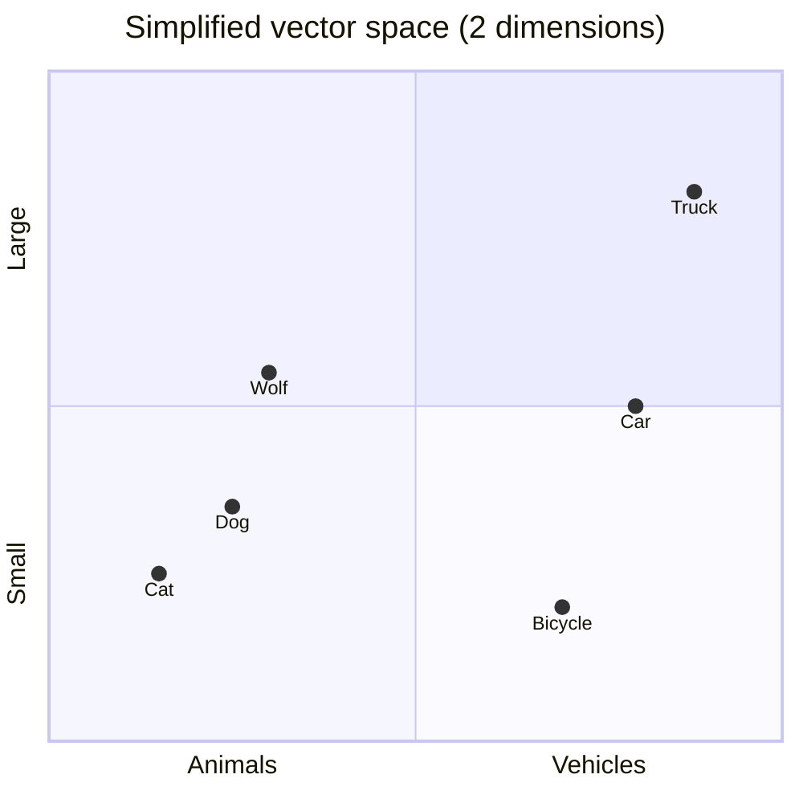
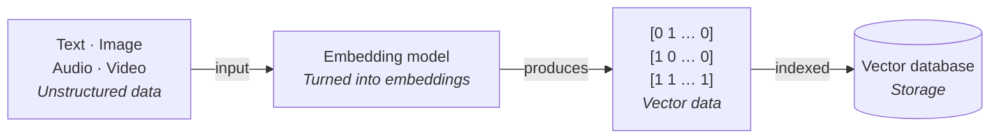
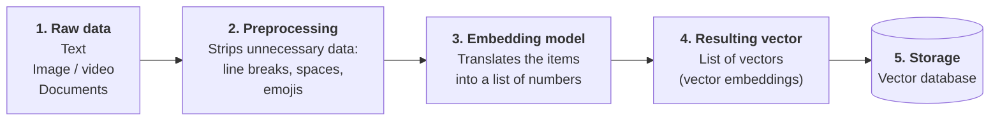
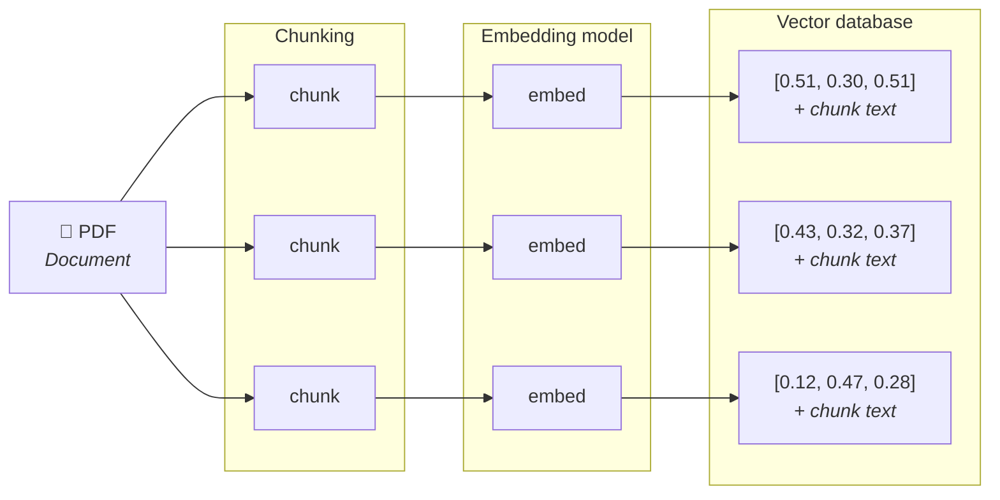
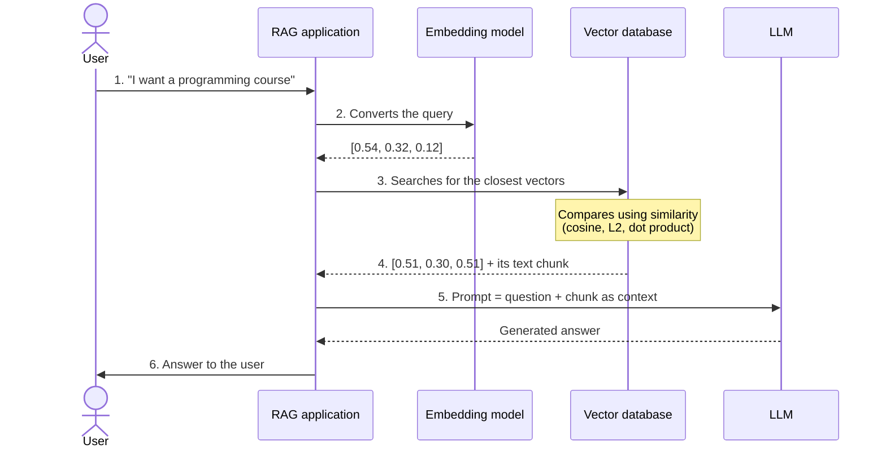
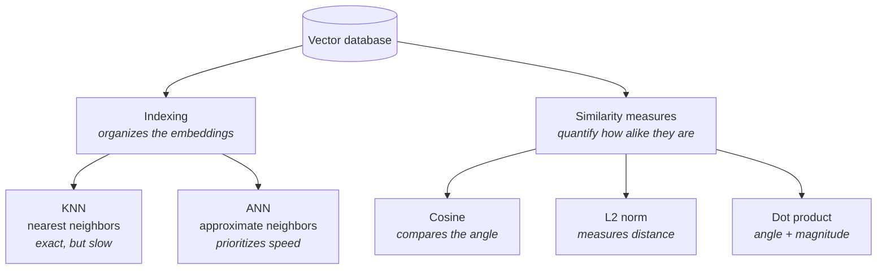

RAG (*Retrieval-Augmented Generation*) is one of the most widely used techniques for getting an LLM to answer with your own information —internal documents, manuals, policies— without retraining it. To really understand it you have to start with its building blocks: vectors, embeddings and vector databases. This article collects my notes on each of them.

> This is **part 1** of a series on RAG. Here we cover the fundamentals; in the next parts we'll put them into practice.

## What is a vector database?

A vector database **turns information into numeric vectors inside a multidimensional space**, which enables searches based on **similarity and meaning**, not just exact text matches.

Each stored item is a list of numbers, and each number holds a position:

```text
[-0.12300456, 0.24304689, -0.15327687, 0.58767916, ...]
```

That list is the item's "position" in the space. It lets us compare **how close two meanings are**: if two vectors are near each other, their content is similar.

For example, if we shrink the space down to just two dimensions, words with similar meanings end up clustered together:



*Cat* and *dog* sit close together and far from *truck*. A real model does the same thing, just with hundreds of dimensions instead of two.

### A quick refresher: what is a vector?

A **vector** is an ordered list of numbers that has **direction** and **magnitude**:

- **Direction** tells you where it points.
- **Magnitude** tells you how strong or important that direction is.

In a three-dimensional space (x, y, z), the vector `[3, 2, 1]` points to a specific spot, and each axis is one dimension.

In AI the idea is the same, just at a different scale: models can work with **hundreds or thousands of dimensions**, and each one represents a different trait of the content, such as tone, context or topic.

### From unstructured data to vectors

The general path looks like this:



## What are embeddings?

An embedding **is a vector, but instead of measuring, it learns meaning**: it turns ideas, text or images into numbers that capture what they mean. If I had to sum it up in one line:

> An embedding is a **vector with meaning**.

### Ingestion process

Before you can search, you need to load the information. The process has five steps:



1. **Raw data:** text, images, videos or documents.
2. **Preprocessing:** strip unnecessary data such as line breaks, extra spaces or emojis.
3. **Embedding model:** translates each item into a list of numbers.
4. **Resulting vector:** you get the list of vectors (the *vector embeddings*).
5. **Storage:** the vectors are saved in the vector database.

### Technical flow

In practice, a large document isn't turned into a single vector. It's first **split into fragments** (*chunks*), and each chunk goes through the embedding model:



Each chunk produces **one vector**, and the database stores that vector alongside the chunk's original text. That detail matters: search compares vectors, but what you get back is the text.

## Query flow

Once the information is stored, this is how a question gets answered:



1. The **user** asks something, for example: *"I want a programming course"*.
2. The query **is turned into an embedding** with the **same model** used during ingestion: `[0.54, 0.32, 0.12]`. With different models, the vectors wouldn't be comparable.
3. The query vector is **compared** with the embeddings stored in the vector database.
4. The **most similar vector** is picked, for example `[0.51, 0.30, 0.51]`, and its associated **text chunk** is retrieved.
5. The **LLM** receives the question along with that chunk as context, analyzes it and generates an answer.
6. The **answer** reaches the user.

## The full RAG model

Putting it all together, RAG breaks down into the three stages that give it its name:


The **ingestion** we saw earlier (PDF → chunks → embeddings → vector database) happens only once, or whenever the documents change; the three RAG stages run on **every query**.

- **Retrieval:** the query is turned into an embedding and the most similar chunks are looked up in the vector database.
- **Augmented (context enrichment):** those chunks are inserted as context into a prompt template, alongside the original question.
- **Generation:** the LLM answers using that enriched context.

## Two key concepts



### Indexing

Indexing **organizes the embeddings** so search stays efficient. It relies on algorithms such as:

- **KNN** (*k-nearest neighbors*): finds the closest neighbors exactly.
- **ANN** (*approximate nearest neighbors*): trades a bit of accuracy to **prioritize speed**, which is essential once you have millions of vectors.

### Similarity measures

They let you **quantify how alike two vectors are**. The most common ones are:

- **Cosine similarity:** compares the angle between vectors, that is, their direction.
- **L2 norm:** measures the Euclidean distance between them.
- **Dot product:** combines direction and magnitude.

## Conclusion

RAG isn't magic: it's a vector database that finds the content whose meaning is closest to the question, and an LLM that writes the answer using that content as context. Understanding vectors and embeddings is what lets you make good decisions when implementing it: how to chunk your documents, which embedding model to use and which similarity measure to choose.

In **part 2** of this series we'll walk through a technical example to see all of these concepts in action.
