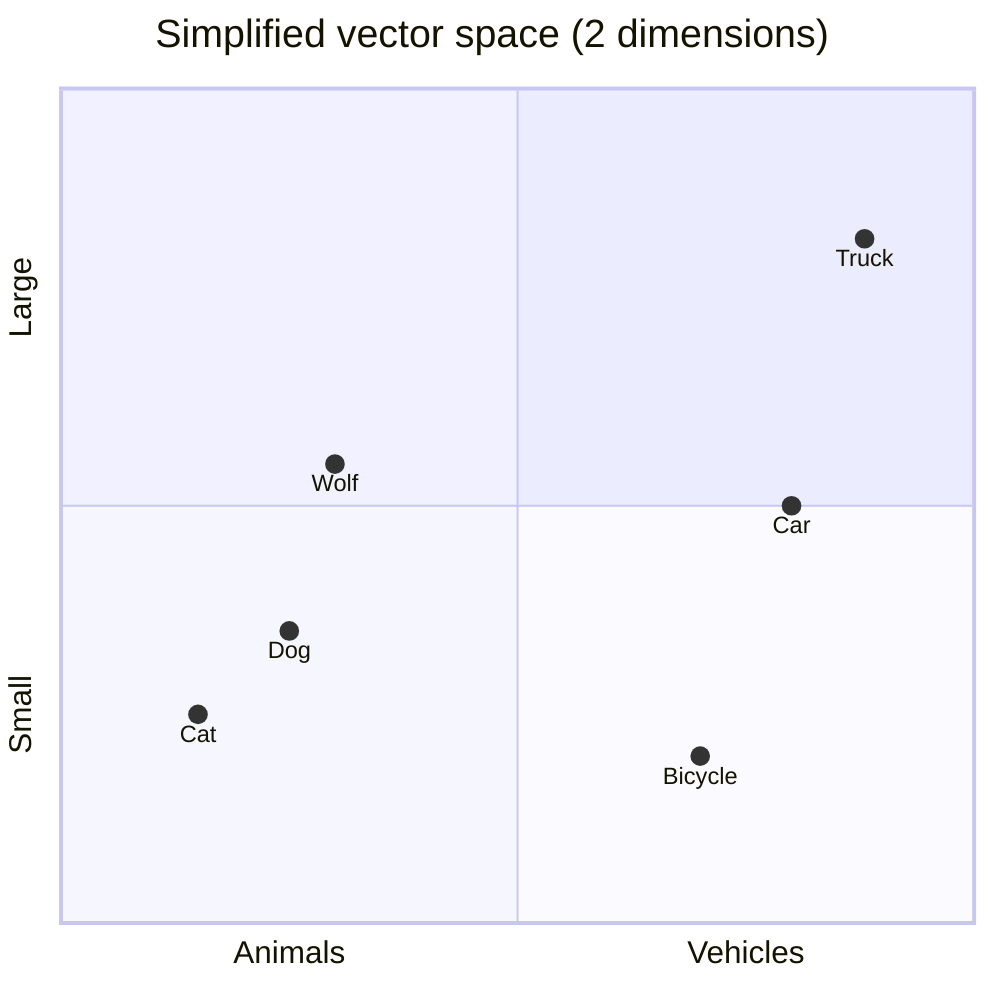
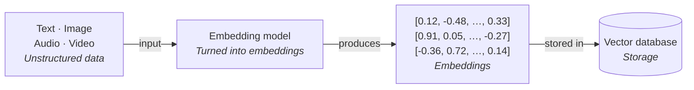
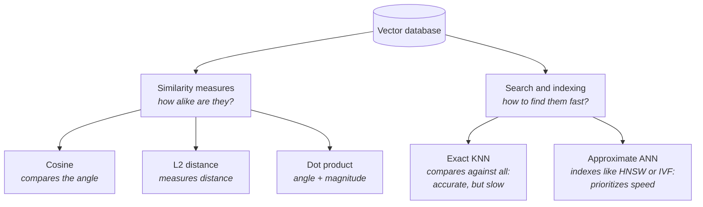
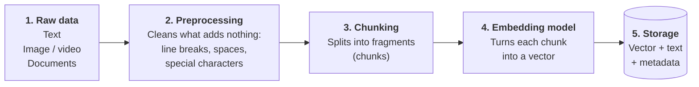
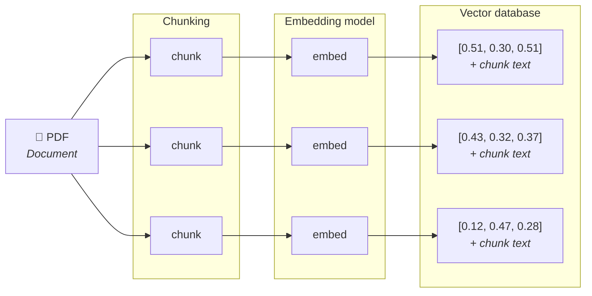
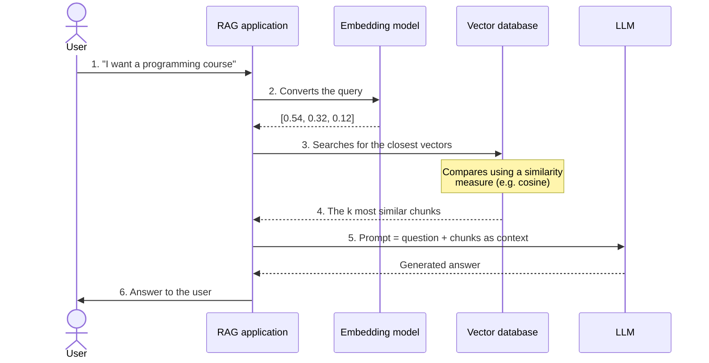
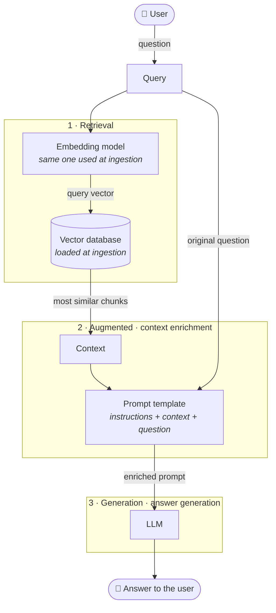

RAG (*Retrieval-Augmented Generation*) is one of the most widely used techniques for getting an LLM to answer with your own information —internal documents, manuals, policies— without retraining it. To really understand it you have to start with its building blocks: vectors, embeddings and vector databases. This article collects my notes on each of them, ordered from the most basic to the full picture.

> This is **part 1** of a series on RAG. Here we cover the fundamentals; in the next parts we'll put them into practice.

## What problem does RAG solve?

An LLM only knows what it saw during training. It knows nothing about your company's internal documents or anything that changed after its cutoff date, and when it doesn't know something it may make up an answer that sounds convincing.

RAG solves this in three steps that give it its name:

1. **Retrieval:** finds the information relevant to the question in your own documents.
2. **Augmented:** adds that information to the prompt as context.
3. **Generation:** the LLM answers based on that context.

The key question is how to find "the relevant information" quickly and by **meaning**, not just by exact words. That's what vectors, embeddings and a vector database are for.

## Vectors: the foundation

A **vector** is an ordered list of numbers. Geometrically, you can picture it as an arrow with **direction** and **magnitude**:

- **Direction** tells you where it points.
- **Magnitude** is its length: how far it reaches in that direction.

In a three-dimensional space (x, y, z), the vector `[3, 2, 1]` points to a specific spot, and each axis is a dimension. The vectors used in AI work the same way, but with **hundreds or thousands of dimensions**:

```text
[-0.12300456, 0.24304689, -0.15327687, 0.58767916, ...]
```

Each number is the item's position along one of those dimensions. What matters is that, in that space, the **distance** between two vectors can be measured, and that's what will let us compare meanings.

## Embeddings: vectors with meaning

An **embedding** is a vector that represents the **meaning** of a piece of content: a text, an image or an audio clip. It's produced by an **embedding model**, a neural network trained so that content with similar meaning produces vectors that sit close together.

> An embedding is a **vector with meaning**.

If we shrink the space down to just two dimensions, words with similar meanings end up clustered together:



*Cat* and *dog* sit close together and far from *truck*. A real model does the same thing, just with hundreds of dimensions. One caveat: in this example each axis has a name ("animals", "size") to make it easy to read, but in a real model individual dimensions have no meaning of their own. Traits like topic, tone or context are spread across many of them at once.

The general path for turning data into embeddings looks like this:



## Vector databases

A **vector database** stores embeddings and lets you find the ones **closest** to a given vector. Unlike a traditional search, which matches exact words, it searches by **similarity of meaning**: a query about "programming courses" can find a document about "software development training" even if they share no words at all.

Each record usually holds three things:

- The **vector** (embedding), used for searching.
- The chunk's **original text**, which is what gets returned.
- Optional **metadata**, such as the source document or date, used for filtering.

For search to work, the database has to answer two questions: **how to measure** how alike two vectors are, and **how to search quickly** among millions of them.



### Similarity measures

They let you **quantify how alike two vectors are**:

- **Cosine similarity:** compares the angle between vectors, that is, only their direction. It's the most common choice for text embeddings. The higher the value, the more alike.
- **L2 distance** (*L2 norm* or Euclidean distance): measures the straight-line distance between the two points. The smaller the distance, the more alike.
- **Dot product:** combines direction and magnitude. If the vectors are normalized (all with magnitude 1), it ranks results the same way as cosine similarity.

The safest choice is the measure the embedding model was trained for; its documentation usually says which one.

### Search and indexing

Finding the vectors closest to a query is known as **nearest neighbor** search. There are two approaches:

- **Exact KNN** (*k-nearest neighbors*): compares the query against **every** stored vector. It always finds the closest ones, but gets slow once you have millions of records.
- **ANN** (*approximate nearest neighbors*): uses an **index** that organizes the vectors ahead of time —for example **HNSW**, graph-based, or **IVF**, cluster-based— so only part of them needs checking. It trades a bit of accuracy for **a lot of speed**, and it's what most production vector databases use.

## Ingestion: how information gets loaded

Before you can search, the documents have to be loaded into the vector database. This process is called **ingestion** and it runs once, or whenever the documents change:



1. **Raw data:** text, images, videos or documents such as PDFs.
2. **Preprocessing:** strips whatever carries no meaning, such as line breaks, repeated spaces or special characters. What to clean depends on the case: emojis, for example, can be noise or can convey the tone of a message.
3. **Chunking:** the document is split into smaller fragments.
4. **Embedding model:** each chunk is turned into a vector.
5. **Storage:** each vector is saved along with its text and metadata.

### Why split into chunks?

A large document isn't turned into a single vector, for two reasons. Embedding models have a limit on how much text they can process, and a vector summarizing fifty pages mixes too many topics to be found precisely. With chunks, each vector represents one concrete idea:



Each chunk produces **one vector**, and the database stores that vector alongside the original text. That detail matters: search compares vectors, but what gets retrieved and handed to the LLM is the **text**.

> The three-number vectors in these examples are a simplification. A real embedding has hundreds or thousands of dimensions.

## Querying: how a question gets answered

Once the information is loaded, this is how a question gets answered:



1. The **user** asks something, for example: *"I want a programming course"*.
2. The query **is turned into an embedding** with the **same model** used during ingestion: `[0.54, 0.32, 0.12]`. With different models, the vectors wouldn't be comparable.
3. The vector database **compares** the query vector with the stored ones, using the configured similarity measure.
4. The **k most similar chunks** (the *top-k*, usually between 3 and 10) are retrieved along with their text. For example, the chunk whose vector is `[0.51, 0.30, 0.51]`.
5. The **LLM** receives the question along with those chunks as context and generates an answer based on them.
6. The **answer** reaches the user.

## The full RAG model

Putting all the pieces together, this is the path a query takes through the three RAG stages:



- **Retrieval:** the query is turned into an embedding and the most similar chunks are looked up in the vector database.
- **Augmented (context enrichment):** those chunks are inserted into a prompt template, along with instructions (for example, *"answer only with the information in the context"*) and the original question.
- **Generation:** the LLM answers based on that enriched context.

Ingestion happens only once; these three stages run on **every query**.

## Conclusion

RAG isn't magic: it's a vector database that finds the content whose meaning is closest to the question, and an LLM that writes the answer using that content as context. Understanding vectors and embeddings is what lets you make good decisions when implementing it: how to chunk your documents, which embedding model to use, which similarity measure to choose and how many chunks to retrieve.

In **part 2** of this series we'll walk through a technical example to see all of these concepts in action.
