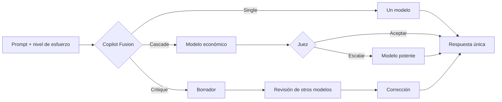

Durante el último año, una de las preguntas que más he escuchado de los equipos es: *"¿Qué modelo debería usar para esto?"*. Cada desarrollador terminaba con su propia receta: un modelo para el día a día, otro "para cuando la cosa se pone difícil" y uno más caro que se reservaba para emergencias. Para quienes lideramos la adopción de IA en el SDLC, eso significaba algo incómodo: el costo y la calidad dependían de una decisión manual que nadie estaba midiendo.

En GitHub Universe (28 de octubre de 2026), GitHub presentó **Copilot Fusion**, y lo interesante es que ataca justamente ese problema.

## ¿Qué es Copilot Fusion?

Copilot Fusion **no es un modelo nuevo**. Es un motor de orquestación que decide, en tiempo de ejecución, qué modelo (o qué combinación de modelos) resuelve cada tarea y devuelve una sola respuesta. En palabras de Mario Rodriguez, CPO de GitHub: *"No es un modelo. Es un motor de orquestación en tiempo de ejecución"*.

Está disponible en todos los planes de Copilot, en VS Code, la app de GitHub Copilot, Copilot CLI y los IDEs de JetBrains.

El cambio para el desarrollador es simple: en lugar de elegir un modelo, elige un **nivel de esfuerzo**:

- **Standard:** modelos versátiles para el trabajo diario.
- **High:** tareas más complejas, como bugs difíciles o cambios en varios archivos.
- **Max:** prioriza los modelos más capaces para los problemas más difíciles.

## Cómo orquesta los modelos

Por cada prompt, Fusion elige uno de tres patrones de ejecución:

- **Single:** un solo modelo responde directamente.
- **Cascade:** un modelo más económico propone una solución, un "juez" la evalúa y, si no es suficiente, escala a un modelo más potente.
- **Critique:** un modelo propone, otros la revisan y el modelo original corrige su propuesta.

El pool incluye modelos de distintos proveedores (Artificial Analysis reportó Claude Opus 5.5, Claude Sonnet 5.5 y modelos GPT-6, entre otros), y los modelos usados **varían según la solicitud y según las políticas que defina la organización**. Esa última frase es la que más me importa como arquitecto, y vuelvo a ella más abajo.

## Lo que dicen los números (y lo que no)

La evaluación independiente de Artificial Analysis, publicada el mismo día del anuncio, comparó Fusion en nivel Max contra Claude Code con Claude Opus 5.5 en su configuración Max:

| Métrica | Copilot Fusion (Max) | Claude Code + Opus 5.5 (Max) |
| --- | --- | --- |
| Puntaje en el índice de agentes de código | 60 | ~62 |
| Costo promedio por tarea | USD 5.59 | USD 11.42 |

Es decir: **dos puntos por debajo, a cerca de la mitad del costo por tarea**. Fusion lideró en Terminal-Bench, pero quedó por detrás en FrontierCode (51 frente a 56).

GitHub, por su parte, comunicó cifras más agresivas, como reducciones de costo de hasta 77% en sus propias evaluaciones. Mi recomendación es separar ambas cosas: el dato independiente es el que usaría para una conversación con finanzas; el de la empresa, como una hipótesis a validar con nuestros propios repositorios.

Y hay un matiz que ningún benchmark mide: **el costo por tarea no es el costo de entregar software**. La revisión humana, el retrabajo y la remediación de seguridad no aparecen en la tabla.

## Lo que cambia para quien lidera la IA en el SDLC

Desde mi rol, veo tres impactos concretos.

### 1. El gobierno pasa del modelo al pool

Antes, aprobar el uso de un modelo era una decisión puntual. Con Fusion, cualquier modelo del pool puede terminar procesando el código de un equipo. Eso significa que las revisiones de protección de datos, residencia y cumplimiento deben cubrir **todo el pool**, no solo el modelo "favorito".

La buena noticia es que Fusion respeta las políticas de modelos a nivel de empresa y organización: los administradores pueden ver qué modelos son elegibles, deshabilitar modelos específicos solo para Fusion y definir un nivel de esfuerzo por defecto. En la práctica, esto convierte la lista de modelos permitidos en un control de seguridad más del pipeline, y como tal debería versionarse, revisarse y auditarse.

### 2. Las métricas de costo se vuelven métricas de ingeniería

Fusion no tiene un cargo adicional: se factura cada modelo que participa, a su tarifa estándar. Un nivel High o Max puede invocar varios modelos en una misma tarea, así que el costo por tarea pasa a depender del nivel de esfuerzo que elige cada desarrollador.

Por eso, en lugar de medir solo "adopción" (cuántas personas usan Copilot), conviene empezar a medir:

- **Distribución de niveles de esfuerzo** por equipo y tipo de tarea.
- **Costo por PR aceptado**, no por prompt.
- **Tasa de aceptación y retrabajo** de los cambios generados con cada nivel.
- **Hallazgos de seguridad** introducidos o remediados en cambios asistidos por IA.

Si Max no mejora la tasa de aceptación frente a Standard en un tipo de tarea, ese es un ahorro inmediato que solo vemos si lo medimos.

### 3. El rol del desarrollador sigue moviéndose hacia la evaluación

En un [artículo anterior](/es/blog/copilot-agent-mode-dependabot/) conté cómo, al remediar vulnerabilidades con Copilot en modo agente, el desarrollador pasó de escribir la solución a evaluar la propuesta de la IA. Fusion profundiza ese cambio: ahora tampoco elige la herramienta, solo cuánto esfuerzo invertir. Hay un detalle a tener en cuenta: si Fusion descarta un borrador, las ediciones de archivos que ese borrador ya hizo no se deshacen. La revisión del diff sigue siendo responsabilidad nuestra.

## Cómo lo adoptaría

Si estuviera empezando hoy, seguiría estos pasos:

1. **Revisar la lista de modelos elegibles** para Fusion y alinearla con las políticas de seguridad y datos de la organización.
2. **Definir Fusion en Standard como opción por defecto** y dejar High y Max como decisiones explícitas. En la [segunda parte](/es/blog/copilot-fusion-configuracion/) explico cómo configurarlo.
3. **Configurar presupuestos y alertas** antes de abrirlo a todos los equipos.
4. **Hacer un piloto con métricas de línea base** (costo por PR, aceptación, retrabajo) en dos o tres equipos.
5. **Comparar contra el uso actual** antes de escalar. El descuento temporal de lanzamiento puede distorsionar la foto de costos de las primeras semanas.

## Conclusiones

Copilot Fusion cambia la pregunta de *"¿qué modelo uso?"* a *"¿cuánto esfuerzo merece esta tarea?"*. Para el desarrollador es una simplificación; para quienes lideramos la IA en el SDLC es un cambio de responsabilidad: dejamos de administrar herramientas individuales y empezamos a **gobernar un pool de modelos y a medir su impacto real**.

Los primeros números son prometedores, pero la decisión de escalar no debería salir de un benchmark, sino de nuestras propias métricas de ingeniería: costo por cambio entregado, calidad y seguridad. La IA acelera; la cultura y los datos deciden hacia dónde.

Muchas gracias por el tiempo y espero que este artículo haya sido de ayuda.

**Fuentes:** [documentación de GitHub](https://docs.github.com/copilot/concepts/models/copilot-fusion), [VentureBeat](https://venturebeat.com/orchestration/github-copilot-fusion-mixes-models-to-achieve-near-opus-5-5-coding-performance-at-half-the-per-task-cost) (incluye los datos de Artificial Analysis).
