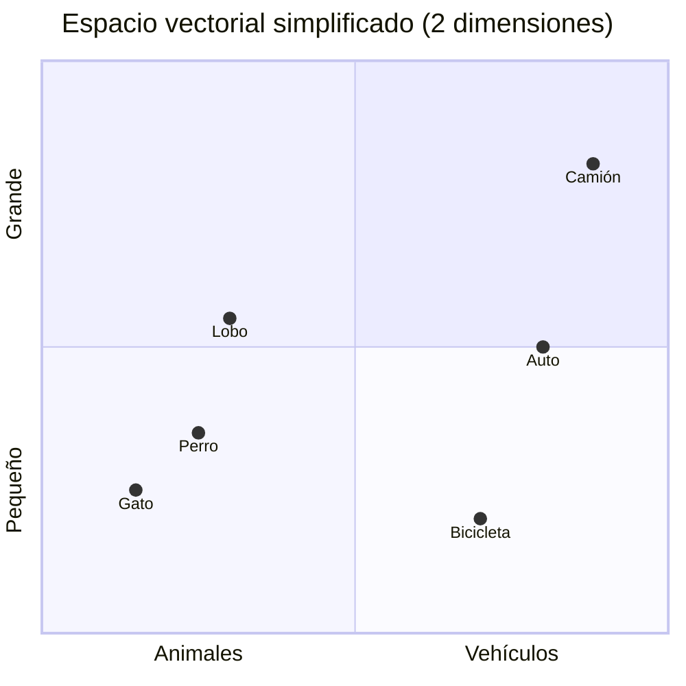
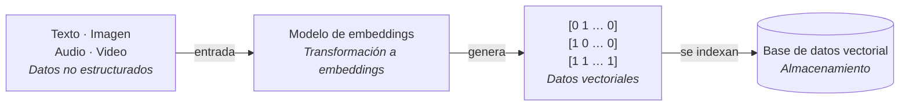
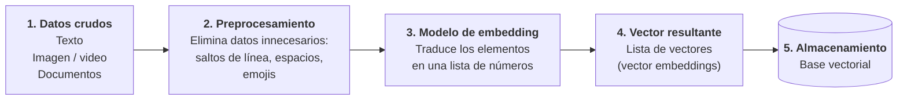
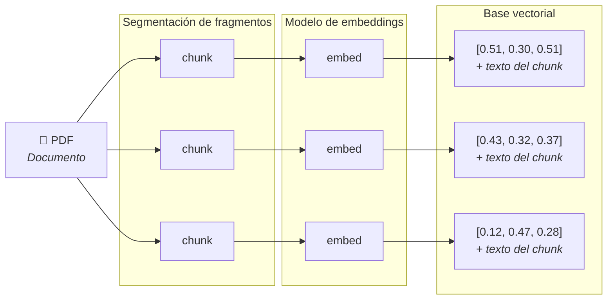
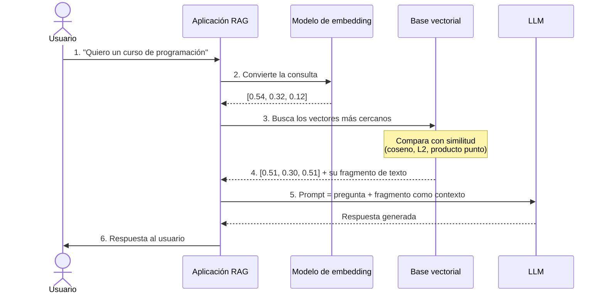
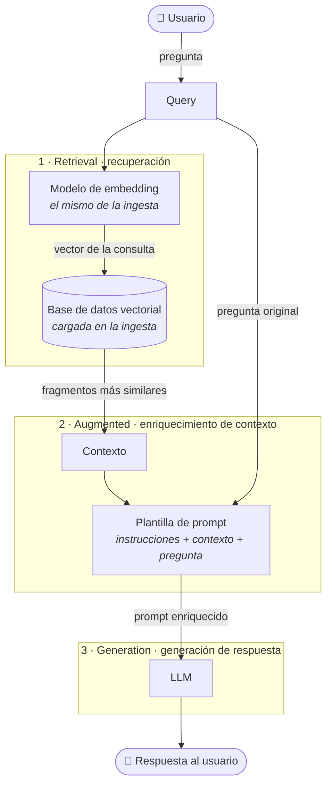
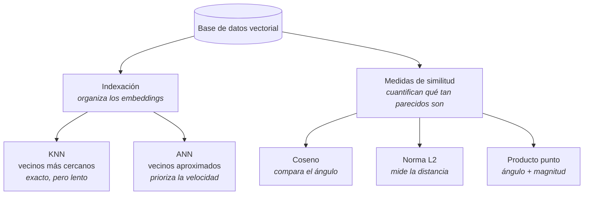

RAG (*Retrieval-Augmented Generation*) es una de las técnicas más usadas para que un LLM responda con información propia —documentos internos, manuales, políticas— sin tener que reentrenarlo. Para entenderlo de verdad hay que empezar por sus piezas: los vectores, los embeddings y las bases de datos vectoriales. Este artículo recoge mis apuntes sobre cada una de ellas.

> Esta es la **parte 1** de una serie sobre RAG. Aquí cubrimos los fundamentos; en las siguientes partes los llevaremos a la práctica.

## ¿Qué es una base de datos vectorial?

Una base de datos vectorial **convierte la información en vectores numéricos dentro de un espacio multidimensional**, lo que permite hacer búsquedas basadas en **similitud y significado**, no solo en coincidencias exactas de texto.

Cada elemento almacenado es una lista de números, y cada número ocupa una posición:

```text
[-0.12300456, 0.24304689, -0.15327687, 0.58767916, ...]
```

Esa lista es la "posición" del elemento dentro del espacio. Gracias a ella podemos comparar **qué tan cercanos son dos significados**: si dos vectores están cerca, su contenido se parece.

Por ejemplo, si simplificamos el espacio a solo dos dimensiones, las palabras con significados parecidos quedan agrupadas:



*Gato* y *perro* están cerca entre sí y lejos de *camión*. Un modelo real hace lo mismo, pero con cientos de dimensiones en lugar de dos.

### Un repaso rápido: ¿qué es un vector?

Un **vector** es una lista ordenada de números que tiene **dirección** y **magnitud**:

- La **dirección** indica hacia dónde apunta.
- La **magnitud** nos dice qué tan fuerte o importante es esa dirección.

En un espacio de tres dimensiones (x, y, z), el vector `[3, 2, 1]` apunta a un punto concreto, y cada eje representa una dimensión.

En IA la idea es la misma, pero a otra escala: los modelos pueden trabajar con **cientos o miles de dimensiones**, y cada una representa un rasgo distinto del contenido, como el tono, el contexto o el tema.

### De datos no estructurados a vectores

El camino general es este:



## ¿Qué son los embeddings?

Un embedding **es un vector, pero en lugar de medir, aprende significados**: convierte ideas, textos o imágenes en números que reflejan su sentido. Si tuviera que resumirlo en una frase:

> Un embedding es un **vector con significado**.

### Proceso de almacenamiento

Antes de poder buscar, hay que cargar la información. El proceso tiene cinco pasos:



1. **Datos crudos:** texto, imágenes, videos o documentos.
2. **Preprocesamiento:** se eliminan datos innecesarios como saltos de línea, espacios extra o emojis.
3. **Modelo de embedding:** traduce cada elemento en una lista de números.
4. **Vector resultante:** obtenemos la lista de vectores (los *vector embeddings*).
5. **Almacenamiento:** los vectores se guardan en la base de datos vectorial.

### Flujo técnico

En la práctica, un documento grande no se convierte en un único vector. Primero se **segmenta en fragmentos** (*chunks*), y cada fragmento pasa por el modelo de embeddings:



Cada fragmento produce **un vector**, y la base guarda ese vector junto con el texto original del fragmento. Ese detalle es importante: al buscar se comparan vectores, pero lo que se recupera es el texto.

## Flujo de consulta

Con la información ya almacenada, así se resuelve una pregunta:



1. El **usuario** hace una consulta, por ejemplo: *"Quiero un curso de programación"*.
2. La consulta **se convierte en un embedding** con el **mismo modelo** usado al almacenar: `[0.54, 0.32, 0.12]`. Si se usaran modelos distintos, los vectores no serían comparables.
3. Se **compara** el vector de la consulta con los embeddings guardados en la base vectorial.
4. Se **escoge el vector más similar**, por ejemplo `[0.51, 0.30, 0.51]`, y se recupera el **fragmento de texto** asociado.
5. El **LLM** recibe la pregunta junto con ese fragmento como contexto, lo analiza y genera una respuesta.
6. La **respuesta** llega al usuario.

## El modelo RAG completo

Juntando todo, RAG se divide en las tres etapas que le dan nombre:



La **ingesta** que vimos antes (PDF → chunks → embeddings → base vectorial) ocurre una sola vez, o cada vez que cambian los documentos; las tres etapas de RAG se ejecutan en **cada consulta**.

- **Retrieval (recuperación):** la consulta se convierte en embedding y se buscan los fragmentos más parecidos en la base vectorial.
- **Augmented (enriquecimiento del contexto):** esos fragmentos se insertan como contexto en una plantilla de prompt, junto con la pregunta original.
- **Generation (generación de la respuesta):** el LLM responde usando ese contexto enriquecido.

## Dos conceptos clave



### Indexación

La indexación **organiza los embeddings** para que la búsqueda sea eficiente. Se apoya en algoritmos como:

- **KNN** (*k-nearest neighbors*): busca los vecinos más cercanos de forma exacta.
- **ANN** (*approximate nearest neighbors*): sacrifica algo de precisión para **priorizar la velocidad**, algo indispensable cuando hay millones de vectores.

### Medidas de similitud

Permiten **cuantificar qué tan parecidos son dos vectores**. Las más comunes son:

- **Similitud coseno** (*cosine*): compara el ángulo entre los vectores, es decir, su dirección.
- **Norma L2** (*L2 norm*): mide la distancia euclidiana entre ellos.
- **Producto punto** (*dot product*): combina dirección y magnitud.

## Conclusión

RAG no es magia: es una base de datos vectorial que encuentra el contenido con el significado más cercano a la pregunta, y un LLM que redacta la respuesta con ese contenido como contexto. Entender los vectores y los embeddings es lo que permite tomar buenas decisiones al implementarlo: cómo segmentar los documentos, qué modelo de embeddings usar y qué medida de similitud elegir.

En la **parte 2** de esta serie abordaremos un ejemplo a nivel técnico para ver todos estos conceptos en acción.
