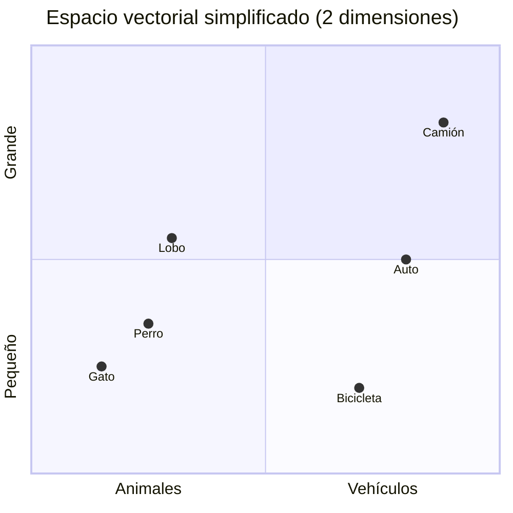
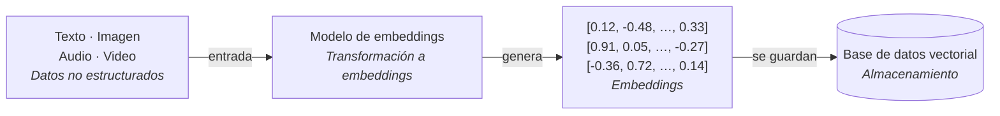
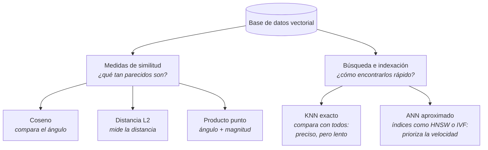
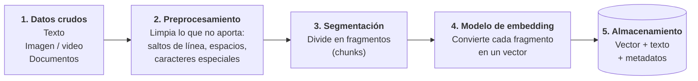
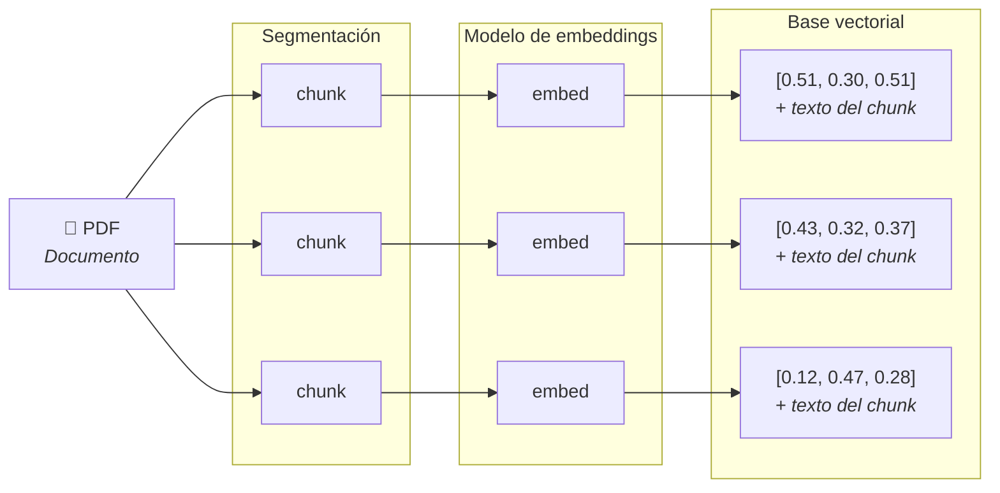
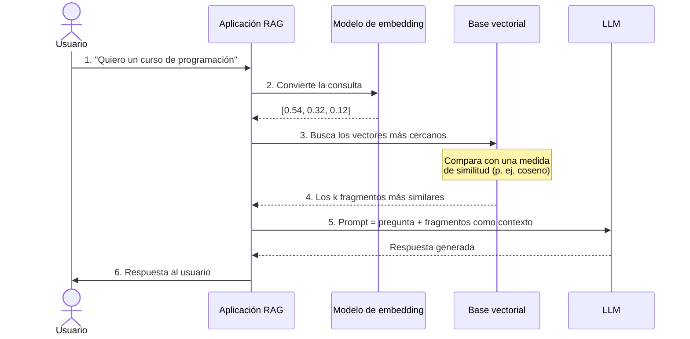

RAG (*Retrieval-Augmented Generation*) es una de las técnicas más usadas para que un LLM responda con información propia —documentos internos, manuales, políticas— sin tener que reentrenarlo. Para entenderlo de verdad hay que empezar por sus piezas: los vectores, los embeddings y las bases de datos vectoriales. Este artículo recoge mis apuntes sobre cada una de ellas, ordenados de lo más básico a lo más completo.

> Esta es la **parte 1** de una serie sobre RAG. Aquí cubrimos los fundamentos; en las siguientes partes los llevaremos a la práctica.

## ¿Qué problema resuelve RAG?

Un LLM solo conoce lo que vio durante su entrenamiento. No sabe nada de los documentos internos de tu empresa ni de lo que cambió después de su fecha de corte, y cuando no sabe algo puede inventar una respuesta que suena convincente.

RAG resuelve esto en tres pasos que le dan su nombre:

1. **Retrieval (recuperación):** busca la información relevante para la pregunta en tus propios documentos.
2. **Augmented (enriquecimiento):** agrega esa información al prompt como contexto.
3. **Generation (generación):** el LLM responde apoyándose en ese contexto.

La pregunta clave es cómo encontrar "la información relevante" de forma rápida y por **significado**, no solo por palabras exactas. Para eso necesitamos vectores, embeddings y una base de datos vectorial.

## Vectores: la base de todo

Un **vector** es una lista ordenada de números. Geométricamente, se puede ver como una flecha que tiene **dirección** y **magnitud**:

- La **dirección** indica hacia dónde apunta.
- La **magnitud** es su longitud: qué tan lejos llega en esa dirección.

En un espacio de tres dimensiones (x, y, z), el vector `[3, 2, 1]` apunta a un punto concreto, y cada eje es una dimensión. Los vectores que se usan en IA funcionan igual, pero con **cientos o miles de dimensiones**:

```text
[-0.12300456, 0.24304689, -0.15327687, 0.58767916, ...]
```

Cada número es la posición del elemento en una de esas dimensiones. Lo importante es que, en ese espacio, la **distancia** entre dos vectores se puede medir, y eso es lo que nos permitirá comparar significados.

## Embeddings: vectores con significado

Un **embedding** es un vector que representa el **significado** de un contenido: un texto, una imagen o un audio. Se obtiene con un **modelo de embeddings**, una red neuronal entrenada para que los contenidos con sentido parecido produzcan vectores cercanos entre sí.

> Un embedding es un **vector con significado**.

Si simplificamos el espacio a solo dos dimensiones, las palabras con significados parecidos quedan agrupadas:



*Gato* y *perro* están cerca entre sí y lejos de *camión*. Un modelo real hace lo mismo, pero con cientos de dimensiones. Una aclaración: en este ejemplo cada eje tiene un nombre ("animales", "tamaño") para que sea fácil de leer, pero en un modelo real las dimensiones no tienen un significado individual. Rasgos como el tema, el tono o el contexto quedan repartidos entre muchas de ellas a la vez.

El camino general para convertir datos en embeddings es este:



## Bases de datos vectoriales

Una **base de datos vectorial** almacena embeddings y permite buscar los que están **más cerca** de un vector dado. A diferencia de una búsqueda tradicional, que compara palabras exactas, aquí se busca por **similitud de significado**: una consulta sobre "cursos de programación" puede encontrar un documento que hable de "formación en desarrollo de software" aunque no comparta ninguna palabra.

Cada registro suele guardar tres cosas:

- El **vector** (embedding), que se usa para buscar.
- El **texto original** del fragmento, que es lo que se devuelve.
- **Metadatos** opcionales, como el documento de origen o la fecha, que permiten filtrar.

Para que la búsqueda funcione, la base necesita resolver dos preguntas: **cómo medir** qué tan parecidos son dos vectores y **cómo buscar rápido** entre millones de ellos.



### Medidas de similitud

Permiten **cuantificar qué tan parecidos son dos vectores**:

- **Similitud coseno** (*cosine*): compara el ángulo entre los vectores, es decir, solo su dirección. Es la más usada con embeddings de texto. A mayor valor, más parecidos.
- **Distancia L2** (*L2 norm* o distancia euclidiana): mide la distancia en línea recta entre los dos puntos. A menor distancia, más parecidos.
- **Producto punto** (*dot product*): combina dirección y magnitud. Si los vectores están normalizados (todos con magnitud 1), da el mismo orden que la similitud coseno.

Lo recomendable es usar la medida para la que fue entrenado el modelo de embeddings; su documentación suele indicarla.

### Búsqueda e indexación

Encontrar los vectores más cercanos a una consulta se conoce como búsqueda de **vecinos más cercanos**. Hay dos enfoques:

- **KNN exacto** (*k-nearest neighbors*): compara la consulta contra **todos** los vectores guardados. Siempre encuentra los más cercanos, pero se vuelve lento cuando hay millones de registros.
- **ANN** (*approximate nearest neighbors*): usa un **índice** que organiza los vectores de antemano —por ejemplo **HNSW**, basado en grafos, o **IVF**, basado en grupos— para revisar solo una parte. Sacrifica un poco de precisión a cambio de **mucha velocidad**, y es lo que usan la mayoría de las bases vectoriales en producción.

## Ingesta: cómo se carga la información

Antes de poder buscar, hay que cargar los documentos en la base vectorial. Este proceso se llama **ingesta** y se hace una vez, o cada vez que los documentos cambian:



1. **Datos crudos:** texto, imágenes, videos o documentos como PDF.
2. **Preprocesamiento:** se limpia lo que no aporta significado, como saltos de línea, espacios repetidos o caracteres especiales. Qué limpiar depende del caso: los emojis, por ejemplo, pueden ser ruido o pueden transmitir el tono de un mensaje.
3. **Segmentación (*chunking*):** el documento se divide en fragmentos más pequeños.
4. **Modelo de embedding:** cada fragmento se convierte en un vector.
5. **Almacenamiento:** cada vector se guarda junto con su texto y sus metadatos.

### ¿Por qué dividir en fragmentos?

Un documento grande no se convierte en un único vector, por dos razones. Los modelos de embeddings tienen un límite de texto que pueden procesar, y un vector que resume cincuenta páginas mezcla demasiados temas como para encontrarlo con precisión. Con fragmentos, cada vector representa una idea concreta:



Cada fragmento produce **un vector**, y la base guarda ese vector junto con el texto original. Ese detalle es importante: al buscar se comparan vectores, pero lo que se recupera y se le entrega al LLM es el **texto**.

> Los vectores de tres números de estos ejemplos son una simplificación. Un embedding real tiene cientos o miles de dimensiones.

## Consulta: cómo se responde una pregunta

Con la información ya cargada, así se resuelve una pregunta:



1. El **usuario** hace una consulta, por ejemplo: *"Quiero un curso de programación"*.
2. La consulta **se convierte en un embedding** con el **mismo modelo** usado en la ingesta: `[0.54, 0.32, 0.12]`. Si se usaran modelos distintos, los vectores no serían comparables.
3. La base vectorial **compara** el vector de la consulta con los guardados, usando la medida de similitud configurada.
4. Se recuperan los **k fragmentos más similares** (el *top-k*, normalmente entre 3 y 10) junto con su texto. Por ejemplo, el fragmento cuyo vector es `[0.51, 0.30, 0.51]`.
5. El **LLM** recibe la pregunta junto con esos fragmentos como contexto y genera una respuesta basada en ellos.
6. La **respuesta** llega al usuario.

## El modelo RAG completo

Juntando todas las piezas, este es el recorrido de una consulta a través de las tres etapas de RAG:


- **Retrieval (recuperación):** la consulta se convierte en embedding y se buscan los fragmentos más parecidos en la base vectorial.
- **Augmented (enriquecimiento del contexto):** esos fragmentos se insertan en una plantilla de prompt, junto con instrucciones (por ejemplo, *"responde solo con la información del contexto"*) y la pregunta original.
- **Generation (generación de la respuesta):** el LLM responde apoyándose en ese contexto enriquecido.

La ingesta ocurre una sola vez; estas tres etapas se ejecutan en **cada consulta**.

## Conclusión

RAG no es magia: es una base de datos vectorial que encuentra el contenido con el significado más cercano a la pregunta, y un LLM que redacta la respuesta con ese contenido como contexto. Entender los vectores y los embeddings es lo que permite tomar buenas decisiones al implementarlo: cómo segmentar los documentos, qué modelo de embeddings usar, qué medida de similitud elegir y cuántos fragmentos recuperar.

En la **parte 2** de esta serie abordaremos un ejemplo a nivel técnico para ver todos estos conceptos en acción.
